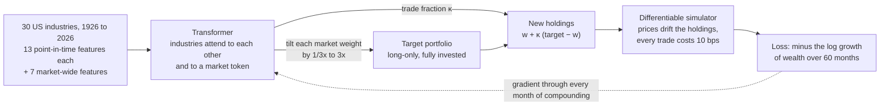

# Deep Portfolio Constructor

**A neural network that builds a long-only portfolio for long-term wealth.** A transformer allocates across Kenneth French's 30 US industry portfolios and decides how much to trade each month. It is trained in PyTorch on the growth of wealth itself, after trading costs, through a differentiable simulator of buying, holding and paying to trade, and tested out of sample from January 1960 to 2026 against the market and five classical long-only strategies, under a protocol committed to git before the test.

**Explore it:** [shmorsi.github.io/projects/deep-portfolio-constructor.html](https://shmorsi.github.io/projects/deep-portfolio-constructor.html). Slide the growth toy, pick a strategy and a start year, and scrub through the network's holdings since 1960.



## Summary

**The question** ([pre-registered](docs/wealth_protocol.md)): can a neural network, trained on the growth of wealth after trading costs, build a better long-only, fully invested, long-term portfolio than simply holding the market, and than the classical rules, from 1960 to 2026?

**The answer:** **Not detectably, by the test fixed in advance.** $1 invested in January 1960 grew to **$1,368** with the network, against **$929** for the market: +0.58% a year in log growth, a gap the pre-registered test cannot tell from luck (Newey-West t = 1.40, 95% interval −0.07% to +1.50%).

* **The rules are a long-term investor's:** long-only, fully invested, no leverage, no shorting, no market timing. Within them the network traded 155% of the portfolio a year (an average holding period of 0.6 years, against 4% a year for the index), and its weights differed from the index's by 32% on average.
* **The strongest classical rival is simple.** A momentum tilt grew +0.96% a year (t = 2.93, better) against the market, trading 110% a year. The network against it: −0.38% a year (t = −0.69, no detectable difference).
* **Classical portfolio rules did not beat holding the market.** Minimum variance, risk parity, equal weight and a classical growth (Kelly) optimiser with the network's own goal and bounds all finished within the noise of the market by the same test.
* **Its edge over the market looks like a value tilt.** Its loading on the Fama-French value factor was 0.17; after adjusting for market, size and value its alpha was +0.15% a year (t = 0.38).
* **Robustness.** Each seed's network on its own ended above the market in 4 of 5 cases ($574 to $1,794); the deployed policy averages them. Re-priced at 25 and 50 bps a trade, the network's growth against the market was +0.13% and −0.63% a year.

## Results

$1 invested in January 1960, out of sample to September 2026 (801 months), long-only, fully invested, net of 10 bps per unit traded. "Growth vs market" is the yearly difference in log growth with its Newey-West t; the verdict follows the pre-registered rule (t ≥ 2 and a 95% block-bootstrap interval that excludes zero).

| Strategy | $1 became | CAGR | Sharpe | Max drawdown | Traded a year | Growth vs market (t) | Verdict |
|---|---:|---:|---:|---:|---:|---:|---|
| Market (hold the index) | $929 | 10.78% | 0.47 | −50% | 4% | benchmark |  |
| Equal weight | $1,377 | 11.44% | 0.49 | −53% | 6% | +0.59% (0.87) | no detectable difference |
| Minimum variance | $1,180 | 11.18% | 0.56 | −41% | 20% | +0.36% (0.33) | no detectable difference |
| Risk parity | $1,418 | 11.49% | 0.51 | −49% | 7% | +0.63% (0.94) | no detectable difference |
| Classical growth optimiser | $905 | 10.74% | 0.47 | −48% | 9% | −0.04% (−0.09) | no detectable difference |
| Momentum tilt | $1,764 | 11.85% | 0.53 | −46% | 110% | +0.96% (2.93) | better |
| **Deep Growth Network** | $1,368 | 11.43% | 0.51 | −52% | 155% | +0.58% (1.40) | no detectable difference |


**What each part of the network adds.** Each ablation was fixed in the protocol and trained with seeds 42 and 43. The full network averaged over the same two seeds turned $1 into $1,026.

| Ablation | What changes | $1 became | Traded a year | Against the market | Against the full network, same seeds |
|---|---|---:|---:|---|---|
| Deep, no learned holding | trades all the way to its target every month (κ fixed at 1) | $1,775 | 252% | +0.97% a year, t 2.11: better | +0.82% a year, t 1.83: no detectable difference |
| Deep, no attention | judges each industry on its own features and the market's (no attention across industries) | $701 | 91% | −0.42% a year, t −0.95: no detectable difference | −0.57% a year, t −1.57: no detectable difference |
| Deep, no market anchor | allocates from scratch with no tilt bounds (no market anchor; untrained, it holds equal weights) | $387 | 354% | −1.31% a year, t −0.47: no detectable difference | −1.46% a year, t −0.55: no detectable difference |

The ablations were fixed in advance to be reported, not to choose a model. “Deep, no learned holding” came out better than the market on its own (t = 2.11), but it is not distinguishable from the full network with the same seeds; with this many comparisons, one pass is weak evidence.

**What it learned.** It did not learn to sit still. Its trade fraction started training at 25% and settled at a median of 81% (range 40% to 100%): it chased its moving target, trading 155% of the portfolio a year. It leaned toward value: its loading on the Fama-French value factor was 0.17 (the market's 0.01), and after adjusting for market, size and value its alpha was +0.15% a year (t = 0.38). The tilts by industry over time:


Every table (decades, costs, seeds, factor alphas, all comparisons) is in [`reports/wealth/results.md`](reports/wealth/results.md). The write-up is [`reports/wealth/research_note.md`](reports/wealth/research_note.md).

## How it works

**Data.** Kenneth French's 30 value-weighted US industry portfolios, monthly, July 1926 to September 2026 (CRSP vintage 202609). Each portfolio holds every listed firm in its industry at each date, including firms that later failed, so there is no survivorship bias. Industry market caps (number of firms times average size) give the market portfolio; rebuilt from the 30 industries it tracks French's own market return with a correlation of 0.9998. The T-bill rate and the Fama-French factors come from the same library.

**Features, known at each month-end.** For every industry, 13 features: returns over 1, 3, 12 (skipping the last month), 36 and 60 months; volatility over 1 and 5 years; downside deviation and drawdown over 3 years; beta and correlation with the market over 5 years; book-to-market (each year's value, formed at the end of June, used from the end of July); and its weight in the index. Each is compared across the 30 industries (z-scored cross-sectionally, clipped at 4). For the market as a whole, 7 more: its 1- and 5-year return, volatility, 3-year drawdown, the T-bill rate, the spread of industry returns and the market's book-to-market, each z-scored against its own past only.

**The network** ([`src/dpc/wealth/model.py`](src/dpc/wealth/model.py), 20,066 parameters). Each industry is a token (its features plus where its current holding sits against the market), with one more token for the market. Two pre-norm transformer blocks (d = 32, 4 heads) let every industry attend to every other. Two heads read the result:

* **Tilt.** Target weights `softmax(log w_mkt + log 3 · tanh(score))`: each industry's market weight is scaled by a factor between a third and three, then the portfolio is rescaled to 100%. Long-only and fully invested by construction. The tilt head starts at zero, so the untrained network holds exactly the market and must earn every deviation on held-out data.
* **Trade fraction.** κ in (0, 1) from the market token: new holdings are `w + κ (target − w)`. κ = 0 is buy and hold, κ = 1 a full rebalance; how much to trade is learned, not set by hand.

**The loss** ([`simulate`](src/dpc/wealth/model.py)). A differentiable copy of the backtest engine plays each policy forward over 60-month episodes: holdings drift with prices, every unit traded costs 10 bps, and the loss is minus the average monthly log growth of wealth after costs (the Kelly criterion). Gradients flow back through every month of compounding, as in deep hedging, so a trade is judged by the years after it. A test checks that this PyTorch simulator reproduces the NumPy engine month by month.

**Walk-forward training** ([`src/dpc/wealth/train.py`](src/dpc/wealth/train.py)). Refits every five years at the end of December, 1959 to 2024, on data before the refit only. Inside each refit the last 10 years are validation (early stopping on validation growth) and no training label is dated after the first validation decision (asserted in code and tested). Five seeds (42 to 46), each warm-started from its own previous refit; the deployed policy averages their targets and trade fractions. AdamW, gradient clipping, batches of 32 episodes.

**The classical strategies** ([`src/dpc/wealth/baselines.py`](src/dpc/wealth/baselines.py)), fixed before the network was run: the market; equal weight and risk parity, each January; minimum variance (Ledoit-Wolf, at most 20% per industry); a classical growth optimiser with the network's own goal and bounds (maximise μ'w − w'Σw/2 within a third and three times the market weights, plug-in estimates); and a momentum tilt within the same bounds, monthly.

## Quick start

**See the results in a minute**, with no download, no training and no PyTorch:

```bash
pip install -r requirements-dashboard.txt
```

```bash
pip install -e .
```

```bash
python -m dpc.cli quickstart
```

`quickstart` prints the headline table and opens a Streamlit dashboard (growth of $1, the network's holdings against the market's at any month, rolling 10-year growth, every table). It reads only committed results.

**Understand it from first principles:** [`notebooks/02_wealth_from_first_principles.ipynb`](notebooks/02_wealth_from_first_principles.ipynb) shows why growth is not average return, finds the Kelly mix by gradient ascent in PyTorch, shows why trading costs teach a policy to trade less, then reads the real results. It runs in a few minutes on a laptop.

**Reproduce everything from raw data** (about two hours on a 4-core laptop CPU):

```bash
pip install -r requirements.txt
```

```bash
python -m dpc.cli wealth
```

Or stage by stage:

```bash
python -m dpc.cli wealth-data        # download French's files, build the panel, check it against French's market
```

```bash
python -m dpc.cli wealth-baselines   # the six classical strategies
```

```bash
python -m dpc.cli wealth-train --variants all   # the network (5 seeds) and the three ablations (2 seeds each)
```

```bash
python -m dpc.cli wealth-reference   # the network averaged over the ablations' two seeds
```

```bash
python -m dpc.cli wealth-evaluate    # metrics, pre-registered comparisons, decades, costs, seeds
```

```bash
python -m dpc.cli wealth-site        # figures, reports/wealth/results.md and the website export
```

```bash
python scripts/write_readme.py       # this README, from the export
```

```bash
pytest
```

Every setting lives in [`config.yaml`](config.yaml) (section `wealth`), and the loader rejects unknown or missing keys.

## Look-ahead safeguards

* **Point-in-time features.** Features at any date are identical whether or not later data exists (tested by truncating the panel). Book-to-market is used only from the July after it is formed; market caps are those known at the decision.
* **Labels end before validation.** No training episode's last return is dated after the first validation decision (asserted in code and tested).
* **One simulator.** The PyTorch training simulator reproduces the NumPy backtest engine month by month (tested), so the network is trained on exactly the rules it is scored on.
* **Pre-registration.** [`docs/wealth_protocol.md`](docs/wealth_protocol.md) fixed the question, the comparisons and the decision rule in git before the network was run out of sample. The classical strategies' parameters were fixed before they were run.
* **Calibration.** A deliberately cheating policy that sees next month's returns, inside the same bounds and costs, turns $1 into $729 million: the simulator pays for real foresight, so an honest result should look nothing like that.

## Limitations

* **Industries, not funds.** An investor in 1960 could not buy these 30 portfolios cheaply; sector funds came decades later. Costs are a flat 10 bps per unit traded, with no taxes or market impact. A taxable investor also pays tax on realised gains, which favours trading even less.
* **The features carry hindsight.** Momentum, value and low volatility were documented by finance research long after 1960, so the network was handed inputs an investor then would not have known to look at. The pre-registration fixes the test, not the feature list.
* **One country, one century.** The US market from 1960 was among the best in the world, and five seeds of one network on one history is a small sample. Several strategies were compared; the pre-registered primary test is the one to read.

## The first study (archived)

This repository began as a market-neutral long-short study (a transformer return model, a transformer covariance model and end-to-end training through a differentiable optimiser, on 99 large caps since 2008). It is archived in [`docs/longshort.md`](docs/longshort.md), with its research note under [`reports/archive/`](reports/archive/); its code, notebook (`notebooks/01_first_principles.ipynb`) and dashboard (`dashboard/longshort_app.py`) still run.
