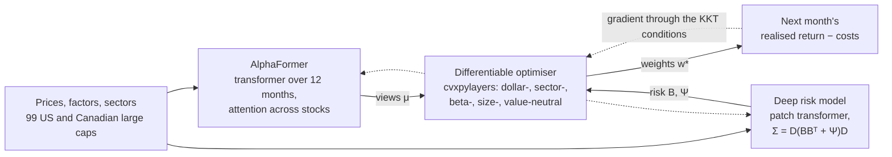
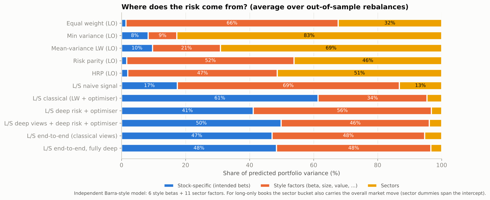

# Deep Portfolio Constructor: the market-neutral long-short study (archived)

> **Archived study.** This is the project's first study, a market-neutral long-short portfolio (2008 to 2026). The project now studies long-only, long-term portfolios: see the [README](../README.md). The code below still runs (`python -m dpc.cli all`), and its results are kept in `reports/` as they were.

**A market-neutral long-short equity portfolio with PyTorch at every layer: a transformer return model, a transformer covariance model, and end-to-end training through a differentiable constrained optimiser. Built as an ablation, so each deep component's contribution is measured, and tested honestly against classical portfolio construction.**

**Explore it:** [shmorsi.github.io/projects/deep-portfolio-constructor.html](https://shmorsi.github.io/projects/deep-portfolio-constructor.html). Step through the ablation, scrub through the real portfolio month by month, and neutralise a toy portfolio yourself.



## Summary

Three textbook signals (12-1 momentum, short-term reversal, low volatility) are turned into a dollar-neutral portfolio of 99 US and Canadian large caps, in six ways. Every long-short strategy uses the same convex optimiser (neutral to sectors, market beta, size and value, with position caps and a turnover limit). Only the inputs change, one deep component at a time:

1. **Classical:** Ledoit-Wolf covariance, signal-based expected returns.
2. **+ Deep risk:** a PyTorch transformer forecasts the covariance matrix.
3. **+ Deep views:** **AlphaFormer**, a PyTorch transformer, forecasts next month's cross-sectional returns.
4. **+ End-to-end:** the risk model is trained *through* the optimiser (cvxpylayers) on realised risk-adjusted return after costs.
5. **Fully deep:** AlphaFormer, the risk model and the optimiser are all trained together end to end.

Everything is walk-forward and out of sample from January 2008 to September 2026. Models refit yearly, and the look-ahead checks are explicit.

**Findings:**
* **The optimiser does the risk work.** It raises the share of risk from intended stock bets from **17% to 61%**.
* **End-to-end training through the optimiser gives the best net Sharpe** (**0.58 vs −0.03** classical), but the edge is not statistically significant (t = 1.70). About 37% of it is market beta that leaked through the beta constraint.
* **More deep learning was not better.** Adding AlphaFormer to end-to-end training fell to 0.15 (t = −1.90 against the end-to-end model).

## Results

Out-of-sample, January 2008 to September 2026 (225 months), monthly rebalancing, net of 10 bps per unit traded:

| Strategy | Net Sharpe | Return | Vol | Max DD | FF6 alpha t | Market beta | % risk from intended bets |
|---|---|---|---|---|---|---|---|
| L/S naive signal (no risk model) | −0.40 | −8.7% | 18.4% | −88% | −3.47 | −0.16 | 17% |
| L/S classical (Ledoit-Wolf + optimiser) | −0.03 | −0.6% | 8.0% | −32% | −0.69 | 0.02 | **61%** |
| + deep risk model | −0.05 | −0.9% | 9.5% | −36% | −1.24 | 0.05 | 41% |
| + deep views (AlphaFormer), two-stage | 0.33 | 2.5% | 8.5% | −26% | 0.80 | 0.15 | 50% |
| **End-to-end through the optimiser (primary)** | **0.58** | **4.7%** | 8.6% | −28% | 1.48 | 0.19 | 47% |
| Fully deep end-to-end (adds AlphaFormer) | 0.15 | 1.0% | 9.3% | −31% | 0.04 | 0.17 | 48% |
| Equal weight, long-only (context) | 0.72 | 12.8% | 19.1% | −49% | 3.83* | 0.92 | 1% |

\* Long-only alphas are inflated by survivorship bias (see Limitations). "% risk from intended bets" is the ex-ante stock-specific share of variance under an *independent*, evaluation-only Barra-style model (6 style factors and 11 sectors).

**What each deep component did:**

| Component | Test | Result |
|---|---|---|
| AlphaFormer (views) | Out-of-sample rank IC vs the classical composite | **0.0165** (t 1.25) vs −0.004 for the composite and 0.0161 for momentum alone. Top-minus-bottom quintile +0.47% a month (t 1.63), about double momentum's 0.24%. Not significant. |
| Deep risk model | Gaussian NLL and minimum-variance realised vol vs Ledoit-Wolf | Better likelihood (−2.941 vs −2.899), worse hedge (14.0% vs 13.3%), at every model size. |
| End-to-end training | Paired monthly return vs classical, Newey-West | +0.43% a month, **t 1.70**. Hedging its own trailing beta point-in-time: Sharpe 0.64 → 0.40. |
| Fully deep | Paired vs the end-to-end model | −0.30% a month, t −1.90: overfit (about 250 monthly decisions per refit). |

**Robustness:**
* End-to-end Sharpe across seeds 42/43/44: 0.58 / 0.46 / 0.49.
* Across position caps of 3–10% and sector limits of 2.5–10%: 0.54 to 0.67.
* At 40 bps costs: 0.19.

Full tables, crisis years (2008, 2020, 2022) and sensitivity tests are in [`reports/stage6_evaluation.md`](../reports/stage6_evaluation.md). The 2-page write-up is [`reports/archive/longshort_research_note.md`](../reports/archive/longshort_research_note.md).



## The deep learning (all PyTorch)

| Model | File | Architecture | Loss | Parameters |
|---|---|---|---|---|
| **AlphaFormer** | `src/dpc/deep/alpha_model.py` | transformer over each stock's 12 monthly returns, then self-attention across stocks (permutation-equivariant), 3-seed ensemble | negative information coefficient | 28,033 per member |
| **Deep risk model** | `src/dpc/deep/risk_model.py` | patch transformer over 60 days + 6 factor returns, cross-stock attention, factor-structured Σ = D(BBᵀ+Ψ)D (positive definite by construction) | Gaussian negative log-likelihood (Woodbury) | 29,033 |
| **End-to-end model** | `src/dpc/deep/e2e.py` | the two networks above feed a cvxpylayers optimiser layer; a zero-initialised residual starts it at the classical answer | −(realised return − costs) + λ·realised variance | both, fine-tuned |
| **First-principles optimiser** | `src/dpc/deep/torch_qp.py` | equality-constrained mean-variance solved through its KKT system with `torch.linalg.solve` | used for teaching and tests | none |

Shared PyTorch infrastructure is in `src/dpc/deep/trainer.py`: a `Dataset`/`DataLoader` per month, AdamW, gradient clipping, early stopping on a validation metric, best-weights restore, and device selection (CUDA, Apple MPS or CPU).

## Quick start

**See the results in a minute.** This needs no download, no training and no PyTorch:

```bash
pip install -r requirements-dashboard.txt
```

```bash
pip install -e .
```

```bash
streamlit run dashboard/longshort_app.py
```

This opens the study's Streamlit dashboard (current weights, risk breakdown, exposures against limits, performance against every baseline). It reads only committed results. (`python -m dpc.cli quickstart` now opens the wealth study's dashboard.)

**Understand it from first principles:** open [`notebooks/01_first_principles.ipynb`](../notebooks/01_first_principles.ipynb). It covers:
* why a naive long-short portfolio hides a factor bet
* an optimiser differentiated with autograd
* a model learning the right signal from portfolio P&L alone
* the real models and results

It runs in seconds on a fresh clone.

**Reproduce everything from raw data** (about 2 hours on a 4-core laptop CPU; a GPU is used automatically if present):

```bash
pip install -r requirements.txt
```

```bash
python -m dpc.cli all
```

To run the stages one at a time:

```bash
python -m dpc.cli data          # Stage 1: download, quality-check, build the panel
```

```bash
python -m dpc.cli signals       # Stage 2: signals and information coefficients
```

```bash
python -m dpc.cli baselines     # Stage 3: classical baselines on the shared engine
```

```bash
python -m dpc.cli risk          # Stage 4: walk-forward deep covariance model
```

```bash
python -m dpc.cli alpha         # Stage 4b: walk-forward AlphaFormer
```

```bash
python -m dpc.cli e2e           # Stage 5: end-to-end models through the optimiser layer
```

```bash
python -m dpc.cli robustness    # Stage 6a: model-size and seed reruns
```

```bash
python -m dpc.cli evaluate      # Stage 6b: metrics, risk decomposition, sensitivity, look-ahead checks
```

```bash
python -m dpc.cli site          # figures for the portfolio website, each with its source
```

```bash
pytest                          # the whole suite, every study
```

Every setting lives in [`config.yaml`](../config.yaml), and the loader rejects unknown or missing keys.

## Look-ahead safeguards

* **Point-in-time access.** Strategies see only a `PointInTimeView` that slices data at the decision date.
* **Labels end before refits.** Deep-model training labels must end on or before each refit date, with an embargo between training and validation. Both are asserted in code for the risk model, AlphaFormer and the end-to-end models.
* **Truncation invariance.** Scrambling every return after a date T must leave every decision and every model input up to T unchanged. This is tested and also checked at runtime on the real data.
* **Oracle calibration.** A deliberately cheating strategy that trades on next month's returns scores a Sharpe of 10.6, which shows what look-ahead would look like.

## Limitations

* ⚠️ **Survivorship bias.** No point-in-time index membership was available (no WRDS/CRSP), so the universe is *today's* large caps. This inflates long-only results and penalises the low-volatility signal. Sector labels are current, not point-in-time.
* **Returns-based exposures.** Size and value exposure are rolling betas to SMB and HML, not fundamental characteristics. Beta estimation error is how the end-to-end models carried a realised market beta of about 0.17–0.19 despite an ex-ante limit of ±0.05.
* **No significant improvement.** No deep model's improvement is statistically significant. Six market-neutral variants were compared, so a multiple-testing haircut applies. The fully deep model was run with one seed.
* **Simplified execution.** Trades fill at the monthly close at a flat 10 bps, with no borrow costs, market impact or capacity limits. The sample ends in September 2026 because the Fama-French factors are published with a lag.
