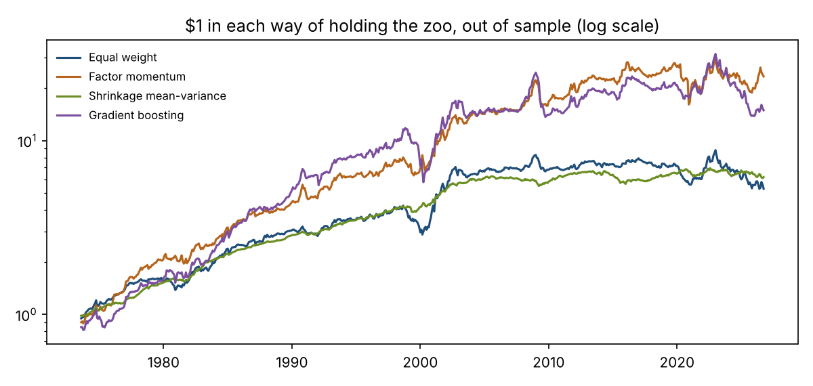

# The anomaly zoo: results

<!-- Generated by `python -m dpc.cli anomalies` from reports/anomalies/summary.json. Do not edit. -->

Fifteen published anomalies as value-weighted top-minus-bottom decile spreads (Kenneth French), 1963-07 to 2026-09 (759 months), gross of trading costs. Not pre-registered.

## 1. Which survive?

4 of 15 clear |t| > 1.96, 1 clears Harvey, Liu and Zhu's 3.0, and 1 survives a Benjamini-Hochberg false-discovery rate of 5%. Only momentum is beyond doubt; the rest are within reach of luck in a field that has tested hundreds of signals.

| Anomaly | Paper | Return a year | Newey-West t | Sharpe | Before publication | After publication | Decay |
|---|---|---:|---:|---:|---:|---:|---:|
| Size (small minus big) | Banz (1981) | 2.1% | 0.80 | 0.13 | 9.6% | -1.0% | 111% |
| Book-to-market | Fama and French (1992) | 4.7% | 1.80 | 0.27 | 6.9% | 2.8% | 59% |
| Operating profitability | Novy-Marx (2013) | 2.9% | 1.34 | 0.20 | 2.3% | 5.3% | -129% |
| Investment (conservative minus aggressive) | Titman, Wei and Xie (2004) | 3.8% | 2.03 | 0.31 | 6.4% | -0.9% | 115% |
| Momentum (12-2) | Jegadeesh and Titman (1993) | 14.3% | 4.56 | 0.56 | 20.4% | 8.7% | 57% |
| Short-term reversal (1-0) | Jegadeesh (1990) | 3.1% | 1.46 | 0.15 | 7.2% | -0.0% | 100% |
| Long-term reversal (60-13) | De Bondt and Thaler (1985) | 3.3% | 1.14 | 0.17 | 8.2% | 0.6% | 93% |
| Accruals | Sloan (1996) | 3.4% | 2.68 | 0.33 | 5.0% | 1.7% | 67% |
| Low beta | Black, Jensen and Scholes (1972) | -2.1% | -0.65 | -0.08 | -4.0% | -1.8% | 57% |
| Net share issuance | Pontiff and Woodgate (2008) | 4.4% | 2.41 | 0.38 | 4.9% | 3.4% | 31% |
| Low volatility | Ang, Hodrick, Xing and Zhang (2006) | 3.9% | 0.94 | 0.14 | 6.3% | -1.3% | 121% |
| Low residual volatility | Ang, Hodrick, Xing and Zhang (2006) | 5.7% | 1.50 | 0.22 | 8.4% | -0.2% | 103% |
| Earnings-to-price | Basu (1977) | 3.2% | 1.46 | 0.21 | 7.5% | 1.9% | 75% |
| Cash-flow-to-price | Lakonishok, Shleifer and Vishny (1994) | 2.7% | 1.28 | 0.18 | 5.9% | -0.3% | 106% |
| Dividend yield | Litzenberger and Ramaswamy (1979) | -0.0% | -0.02 | -0.00 | -0.8% | 0.2% | 128% |

## 2. Did publication kill them?

For the 15 anomalies with at least five years of data before their paper, the average return fell from 6.3% a year before publication to 1.3% after. Pooled with anomaly fixed effects and errors clustered by month, the post-publication change is -5.5% a year (t -2.77): an implied decay of 87%. McLean and Pontiff (2016) found about 58% across 97 anomalies.

## 3. Combining them out of sample

Each month from 1973-07, using only the past (gradient boosting refitted every January). Long-short weights scaled to sum to one in absolute value.

| Strategy | Return a year | t | Volatility | Sharpe | Sharpe since 2000 | Worst fall | Sharpe vs equal weight (90% interval) |
|---|---:|---:|---:|---:|---:|---:|---|
| Equal weight | 3.5% | 2.23 | 8.9% | 0.39 | 0.26 | -40% | the benchmark |
| Factor momentum | 6.8% | 4.19 | 12.7% | 0.53 | 0.37 | -43% | +0.14 (-0.03 to +0.32): no detectable difference |
| Shrinkage mean-variance | 3.5% | 4.97 | 4.1% | 0.86 | 0.34 | -16% | +0.47 (+0.20 to +0.78): better |
| Gradient boosting | 6.0% | 2.58 | 13.4% | 0.45 | 0.26 | -56% | +0.05 (-0.11 to +0.26): no detectable difference |

## Limits

- Decile portfolios, not stocks: no stock-level signal construction, no costs. Short legs of value-weighted deciles are cheaper to trade than equal-weighted ones but not free.
- Publication years are those of the paper usually cited; some anomalies were known earlier in working papers.
- The zoo is fifteen survivors that Kenneth French chose to publish portfolios for, so it is itself a selected set.
