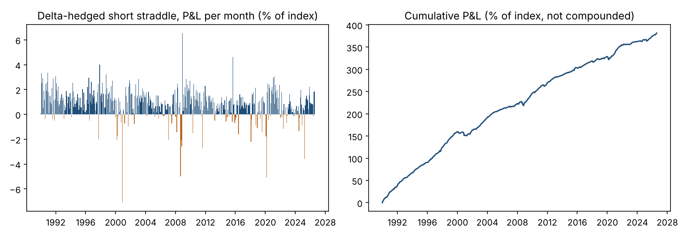

# Derivatives and rates: results

<!-- Generated by `python -m dpc.cli derivatives` from reports/derivatives/summary.json. Do not edit. -->

Not pre-registered: a tested library (`src/dpc/derivatives/`, `tests/test_derivatives.py`) run once on public data.

## 1. The volatility risk premium, delta-hedged, on real data

Each month from 1990-01 to 2026-08 (440 trades): sell a one-month at-the-money straddle on the US stock market at the VIX's volatility, hedge its delta every trading day with the market's actual returns, close at expiry. P&L as a share of the index.

| | Average | Standard deviation | Note |
|---|---:|---:|---|
| Premium collected | 4.49% | | |
| P&L, delta-hedged | 0.867% | 1.21% | Newey-West t 12.68; positive in 83% of months; skew -1.1 |
| P&L, unhedged | 0.892% | 2.41% | |

Implied volatility (VIX) averaged 19.5% against 15.4% realised; implied exceeded realised in 83% of months. Worst months for the hedged seller: 2000-12 (-7.11%), 2020-03 (-5.10%), 2008-09 (-4.99%). The premium is real and so is the crash risk: the seller earns small amounts most months and gives a large share back in a few. The VIX is a 30-day implied volatility across strikes, above at-the-money volatility, so these figures overstate the premium somewhat.

## 2. The Treasury zero curve, bootstrapped

Par yields of 2026-11-19 (FRED), semiannual coupons, bootstrapped into discount factors; every quoted par bond reprices to 100 within 2.8e-14.

| Maturity | Zero rate (continuous) | One-year forward ending then |
|---:|---:|---:|
| 1y | 4.57% |  |
| 2y | 4.71% | 4.85% |
| 5y | 4.81% | 4.91% |
| 10y | 5.01% | 5.36% |
| 20y | 5.54% | 6.71% |
| 30y | 5.42% | 5.11% |

| Receive-fixed swap | Par rate | Annuity | DV01 per 100 notional |
|---:|---:|---:|---:|
| 2y | 4.76% | 1.888 | 0.0193 |
| 5y | 4.86% | 4.398 | 0.0450 |
| 10y | 5.04% | 7.819 | 0.0796 |
| 30y | 5.40% | 14.879 | 0.1494 |

## 3. The pension's swap overlay, priced

The LDI stress test (reports/institutional) needs receive-fixed swaps with a DV01 of 0.1181 per 100 of liability. On today's curve a 30-year swap at par (5.40%) has a DV01 of 0.00149 per unit of notional (a duration of 14.9 years), so the overlay is 79.0 of 30-year notional per 100 of liability; the stress test, which uses a duration of 15, assumed 78.7.

## 4. Checks against the textbook

- Black-Scholes, Hull Example 15.6: call 4.7594, put 0.8086 (book: 4.76, 0.81).
- American put on a 2,000-step tree (S = K = 50, r 10%, sigma 40%, 5 months): 4.2839; European 4.0760; early-exercise premium 0.2079.
- SABR fitted to a smile it generated: rho -0.3000 (true -0.3), nu 0.4500 (true 0.45), error 8.4e-11.
- Delta-hedging error of a short 3-month call (standard deviation of P&L per 100 of stock) by rebalances: 4: 1.621, 16: 0.843, 64: 0.433, 256: 0.217 (halves for each fourfold increase, as theory says).
